# Mini Turbo Hand Fan & Vacuum (30mm Impeller Rig)

## Final #D CAD view 

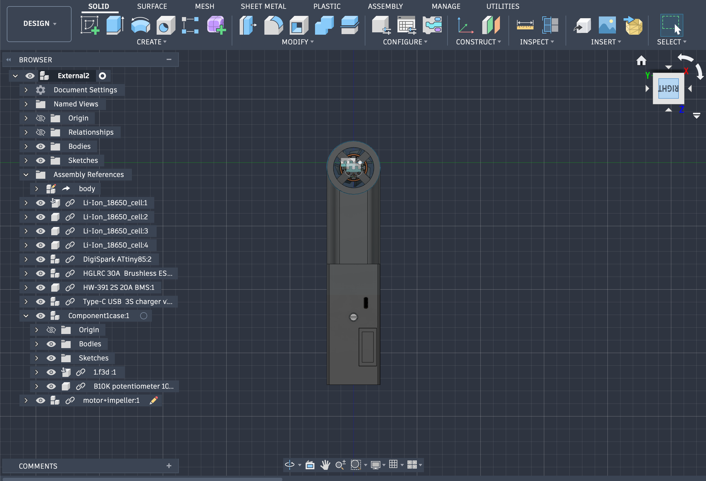
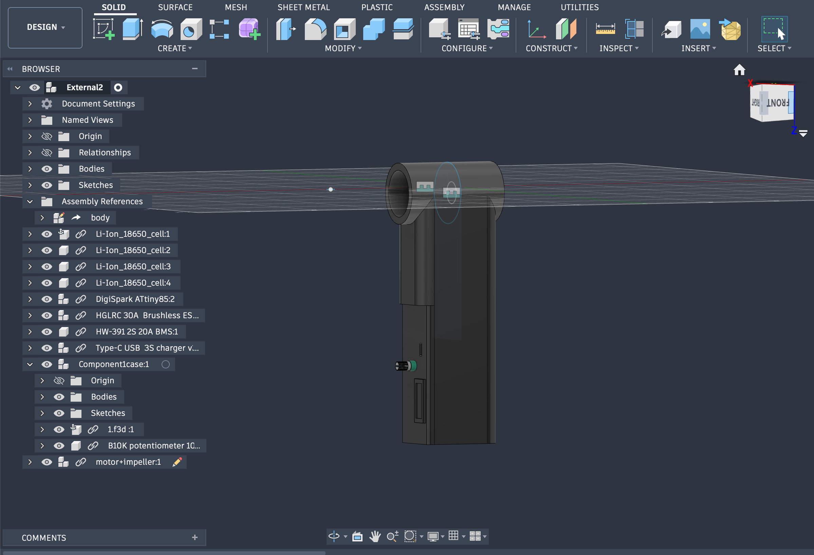
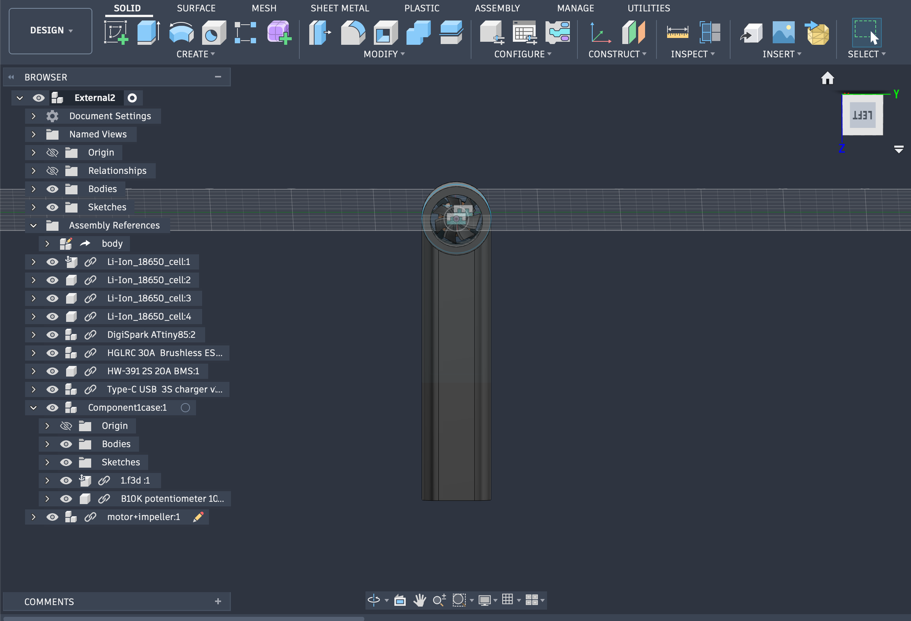
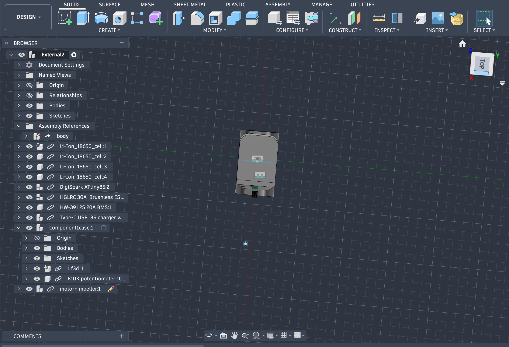  

### Project Overview
This project is a high-speed, multi-purpose mini turbo hand fan capable of doubling as a handheld vacuum cleaner. It is powered by a high-RPM Brushless DC (BLDC) motor controlled by a 30A ESC and an ATtiny85 microcontroller. The core of the project features a custom-designed 30mm impeller, mechanically optimized in Fusion 360 to perfectly balance static pressure and air volume displacement. 

While commercial turbo jet fans with similar performance cost upwards of $70–$80, this project was engineered from the ground up to be fully fabricated for **strictly under $50.00**. It features a custom 3D-printed enclosure housing a rechargeable 4S 18650 Li-ion battery power plant, integrated with a Battery Management System (BMS) and Type-C charging for maximum safety, longevity, and portability.

---

### Hardware & 3D Design Details

**The Impeller**
This is the custom 7-blade impeller designed to mount onto the BLDC motor shaft. It is mechanically optimized to balance high static pressure with maximum air volume displacement, allowing the device to act as both a powerful fan and a vacuum.
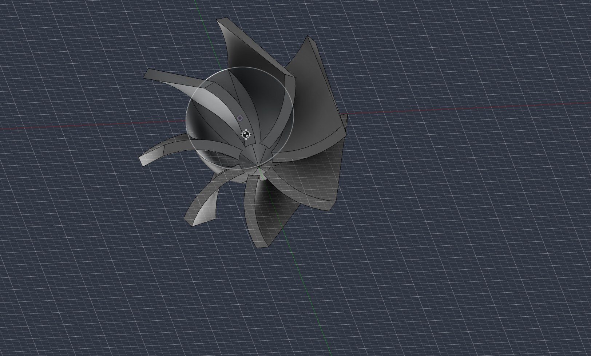
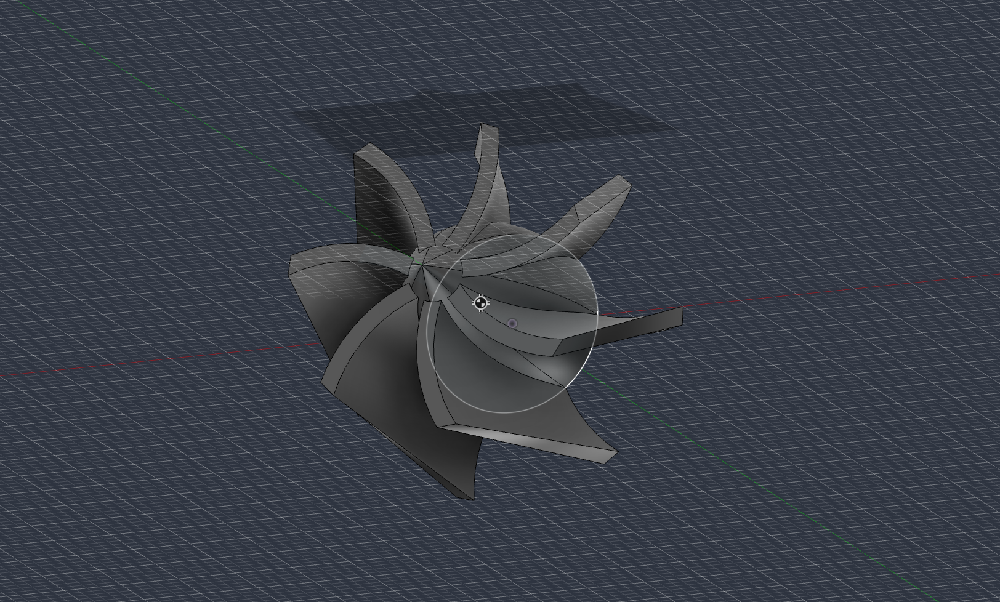

**The Full Main Body**
This is the main body shell of the fan. It features a heavily filleted, ergonomic handle for a comfortable grip during high-thrust operation, along with precise external cutouts for the power button, speed control knob, and Type-C charging module.
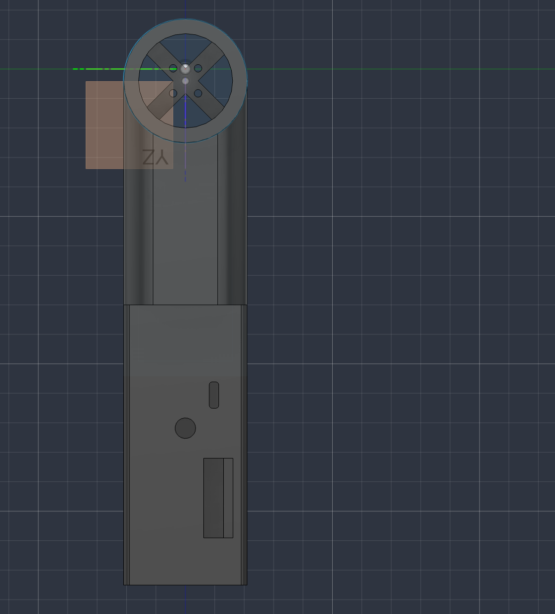

**Internal Battery Compartment**
This is the internal layout showing the dedicated compartments designed to securely house the four 18650 Li-ion cells, the BMS, and all routed wiring without obstructing the main airflow.
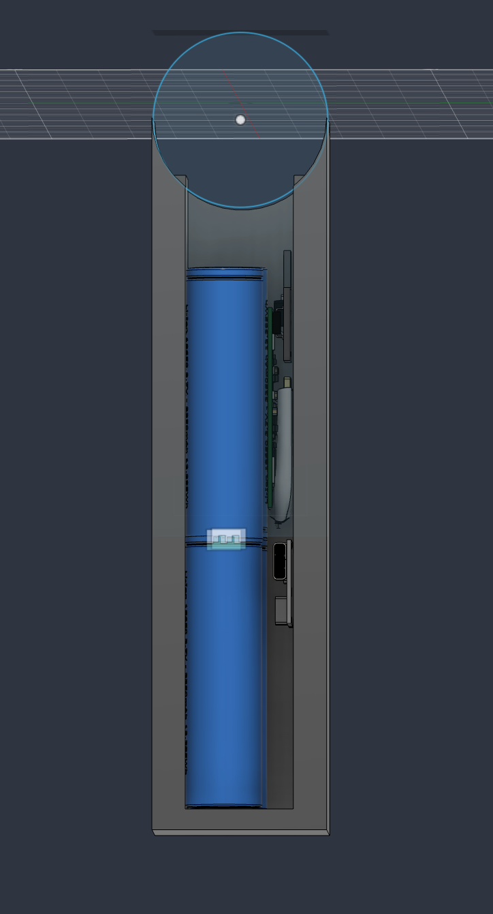

**Final Assembly**
This is the final CAD assembly showing how the motor housing, impeller, and ergonomic handle all fit perfectly together into a single, compact handheld unit.
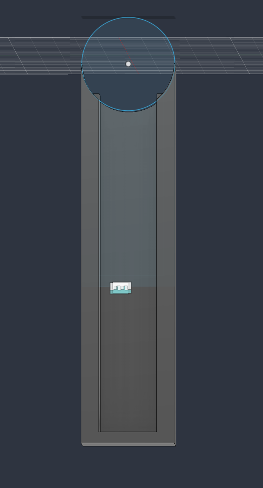
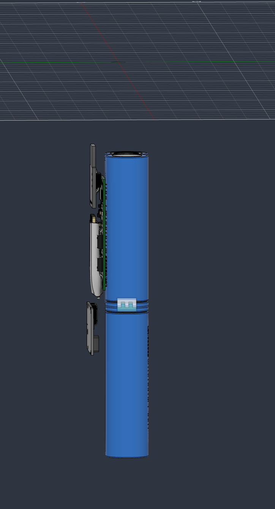

---

### Wiring & Electronics

**Point-to-Point Schematic**
This is the finalized electrical schematic. To strictly maintain the $50.00 budget limit, we bypassed expensive custom PCB fabrication. Instead, I designed a clean point-to-point wiring architecture connecting the ATtiny85, the 30A ESC, and the 4S battery management system.
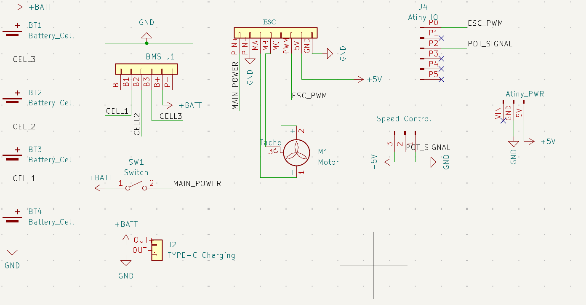

---

**Wiring Diagram**

Please note that all wire colors shown in the circuit diagram are for reference purposes only. Actual wire colors may differ depending on the specific components you are using, but the basic connections will remain the same. Always **cross-verify** the pinouts of your components before making connections. 

**Standard Color Coding Used:**
* 🔴 **Red Wire:** Signifies the Positive (+) / Power line (VCC).
* ⚫ **Black Wire:** Signifies the Negative (-) / Ground line (GND).

### Bill of Materials (BOM)

| Item | Description | Estimated Price (USD) | Verified Link |
| :--- | :--- | :--- | :--- |
| **Digispark ATtiny85** | USB Development Board (Controller) | $2.50 | [Link](https://robu.in/product/attiny85-usb-development-board/) |
| **A2212 1000KV Brushless Motor** | Cost-effective BLDC motor for impeller | $4.00 | [Link](https://robu.in/product/a2212-1000kv-brushless-motor-for-drone/) |
| **SimonK 30A ESC** | Electronic Speed Controller with BEC | $3.80 | [Link](https://robu.in/product/30a-bldc-esc-electronic-speed-controller/) |
| **10k Potentiometer (WH148)** | Rotary dial for throttle control | $0.25 | [Link](https://robu.in/product/wh148-potentiometer-10k-15mm-shaft/) |
| **18650 Li-ion Cells (x4)** | Generic 2500mAh Li-ion Cells | $6.00 | [Link](https://robu.in/product/eve-18650-25p-2500mah-li-ion-battery/) |
| **4S 30A BMS Module** | Battery Management System | $3.20 | [Link](https://robu.in/product/4-series-30a-18650-lithium-battery-protection-board-14-8v-16v-with-cable/) |
| **Type-C 4S Charging Module** | 4S 16.8V 4A 18650 Lithium Battery Charger Module | $3.80 | [Link](https://robu.in/product/4s-16-8v-4a-18650-lithium-battery-charger-module-type-c/) |
| **Solder Wire & Flux Combo** | Plusivo Rosin Paste & 1mm Wire | $2.00 | [Link](https://robu.in/product/plusivo-solder-wire-1mm-100g-and-rosin-paste-flux/) |
| **Barley Insulation Paper** | Battery Pack Insulation Sheet (2m) | $1.00 | [Link](https://robu.in/product/barley-insulation-paper-sheet-100mm-2-meter/) |
| **Dupont Jumper Wires** | Female to Female 20cm (40 Pcs) | $0.65 | [Link](https://robu.in/product/acebott-20cm-dupont-wire-40pin-female-to-female/) |
| **Silicone Hookup Wire** | 14AWG Ultra Flexible Silicone Wire - Red | $0.80 | [Link](https://robu.in/product/high-quality-ultra-flexible-14awg-silicone-wire-red/) |
| **TOTAL** | **Target Budget Met** | **$28.00** | |
